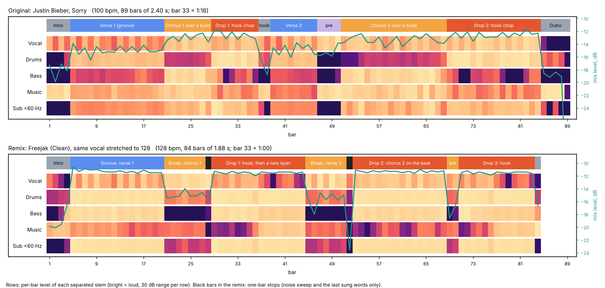

# Sorry: the original against Freejak's remix (Clean)

The person's files, studied whole on sandbox copies on 2026-10-28: "04 Sorry" (Justin Bieber, 2015, produced by Skrillex and BloodPop) and
"Justin Bieber - Sorry - Freejak Remix (Clean)". Freejak is a UK remixer and producer whose page lists remixes for Paul Oakenfold, Kelis,
Sigala and Craig David ([Freejak on Bandcamp](https://freejak.bandcamp.com/)). Both files went through `build_song_analysis` (beat grid,
RoFormer vocal, Demucs drums, bass and other stems, Whisper words), then every bar of both was measured: per-stem level, three-band drum
step profiles, bass notes, chord readings, the vocal's pitch, tuning and formants, stereo width, loudness per section. Lines are named by
number and function below, never quoted. What only ears can confirm is marked.

## The reading

Freejak made a short club edit at the house tempo: the whole vocal, every line in its order, sped up from 100 to 128 bpm with its pitch,
key and tone untouched, over a new four-on-the-floor track with new chords. The form follows the record bar for bar, but each pass gets a
different job: verse 1 rides the full groove, chorus 1 is sung over a break with the bass gone, a bar of near silence, then the drop
plays the record's own vocal-chop hook; verse 2 moves into a second break, and chorus 2 is sung on the full drop beat. The drops are no
louder than the verse groove (within 0.5 LU): the energy comes from taking things away, three breaks and two stop bars in 2:39. The move
that makes it still sound like "Sorry": the record's dembow syncopation lives on as a dotted-8th bass and pluck rhythm on top of the
straight house kick.

## Facts

| | Original | Remix |
| --- | --- | --- |
| Length, bars | 3:21, 89 bars of 2.400 s | 2:39, 84 bars of 1.875 s |
| Tempo | 100.0 bpm, steady (grid residual 9.2 ms) | 128.0 bpm, steady (7.1 ms), no tempo change anywhere |
| Genre | dancehall pop, tropical house, moombahton on a dembow riddim ([Wikipedia](https://en.wikipedia.org/wiki/Sorry_(Justin_Bieber_song))) | house (file tag "Dance") |
| Key | E flat major, a loop of IV, vi, V that never plays the E flat chord ([Soundfly](https://flypaper.soundfly.com/discovery/music-theory-analysis-justin-bieber-sorry-surprisingly-hip/)); our vote reads B flat major for the same reason | the vocal's E flat major; the file's key tag says F minor (a detector reading the F and G basses; F Dorian has E flat major's notes) |
| Tuning (pYIN, cents from A440) | vocal +3, bass -1 | vocal +3, bass +5: nothing retuned |
| Vocal pitch (MIDI, 5/25/50/75/95 %) | 55.0, 58.1, 63.1, 67.1, 77.0 | 55.1, 59.9, 63.1, 71.1, 77.0 |
| Vocal formants F1, F2 (median) | 643, 1551 Hz | 665, 1582 Hz (+3 %, +2 %) |
| Loudness | -7.3 LUFS, +1.2 dBTP, LRA 3.9 LU | -7.5 LUFS, +1.2 dBTP (decoded MP3), LRA 3.1 LU |
| Width below 150 Hz (side under mid) | 13 dB | 35 to 38 dB: mono |
| Width above 4 kHz | 7 dB | 3 dB: wider |

## Tempo, key and the vocal's tone

- **The stretch.** 128 / 100 is x1.28: far past the 10 % Langford gives as a comfortable stretch, inside the coproducer's 1.35 limit. A
  professional chose house's standard tempo over the smallest stretch. Line starts in the remix sit at 0.76 to 0.80 of the original's
  spacing (1/1.28 is 0.78): one uniform stretch, no re-singing, no re-timing.
- **Pitch and key kept.** The median and the spread of the sung notes are identical, and so are the shares of each pitch class. Sped up
  like tape the vocal would sit 4.3 semitones higher.
- **Tone kept.** Formants move 2 to 3 %, brightness per section stays within 10 %, the level 150 to 400 ms after a phrase ends rises
  from -3.9 to -2.0 dB against the phrase: at most a little more ambience, no wash. No line is filtered, pitched, stuttered or re-cut. In
  FL this is a stretch with formant preservation: e3 Mono (made for vocals, offline, fine because the tempo never changes) or Stretch pro
  with F.Shift at 0 ([FL Studio manual, Sampler time stretching](https://www.image-line.com/fl-studio-learning/fl-studio-online-manual/html/chansettings_sampler.htm)).
  Ears: whether the long notes show stretch artifacts.

## Where every line went

All 31 transcribed lines of the original are accounted for in order; the matcher found 20 (repeated chorus lines count once, at their
first use, and line 5 was split in two by the transcriber but is sung whole).

| Original lines | What they are | In the remix |
| --- | --- | --- |
| 1 to 6 | verse 1 and its lift into the chorus | whole, 0:07 to 0:36, on the groove (bars 4 to 19) |
| 7 to 10 | chorus 1 | whole, 0:37 to 0:52, in break 1 (bars 20 to 28) |
| 12, 10 | the post-chorus tag | 0:53 to 1:07, in drop 1 over the hook |
| 13, 14 | the original's ad-libs over its first drop | left out |
| 15 to 18 | verse 2 | whole, 1:23 to 1:36, in break 2 (bars 45 to 52) |
| 19 to 26 | chorus 2 | whole, 1:38 to 2:08, on drop 2 (bars 53 to 68) |
| 12 | the tag again | 2:08, in the two-bar breath (bars 69 to 70) |
| 31 | the original's last line (sung over its second drop) | 2:17, in drop 3 |
| 27 to 30 | ad-libs over the original's second drop | left out |

The hook is not a line: it is the record's own manipulated vocal loop (Skrillex showed it made from Julia Michaels' vocal, per
Wikipedia), heard in the intro and through the drops at its own pitch (B flat, C, E flat, F in both versions).

## The form, as functions

| Bars | Time | Function | Vocal | Drums | Bass | Music |
| --- | --- | --- | --- | --- | --- | --- |
| 1 to 2 | 0:00 | intro: cold open | the hook | claps on 2 and 4, hats, no kick | none | chords |
| 3 to 4 | 0:04 | lift-in | hook, then verse 1's pickup | a pickup kick on the last 16th | enters with a fill | top line rising |
| 5 to 12 | 0:08 | groove A | verse 1 | kick alone, four on the floor | dotted-8th, ducked | dark pluck |
| 13 to 20 | 0:22 | groove B | verse 1 to its end | adds clap on 2 and 4, open hat on every off-beat | same | the pluck's filter opens (centroid 1.1 to 1.7 kHz over 8 bars) |
| 21 to 27 | 0:37 | break 1 | chorus 1, whole | lighter syncopated kick, clap on beat 2, rolling 16th hats | out | chords up high |
| 28 | 0:51 | stop | the chorus's last words | out | out | out; a one-bar white-noise sweep |
| 29 to 36 | 0:53 | drop 1, first half | the hook and the tag | full | full, bright (250 Hz to 1 kHz up 10 dB) | low |
| 37 to 44 | 1:08 | drop 1, second half | the hook, further back | full | closed down (14 dB less above 250 Hz) | a louder off-beat chord layer (+15 to +20 dB) |
| 45 to 51 | 1:23 | break 2 | verse 2, whole | as break 1 | out | chords |
| 52 | 1:36 | stop | none | out | out | noise sweep only (mix -18.8 LUFS) |
| 53 to 68 | 1:38 | drop 2 | chorus 2 on the beat | full | full | low under the voice |
| 69 to 70 | 2:08 | breath | the tag | broken | out | chords |
| 71 to 83 | 2:11 | drop 3 | the hook, the last line | full | bright, then closed again from bar 77 | the off-beat layer returns in 77 to 83 |
| 84 | 2:36 | end | none | hats | the last note decays | none |

**Against the original's own form.** The record is already shaped like an EDM pop song: intro 4, verse 1 16, chorus 1 over a build 8 (the
kick out, the 808 up an octave and louder, 3-3-2 hats, a snare roll and a gap in bars 27 and 28), a hook drop of 8, a two-bar hook
reprise, verse 2 8, a lift over pads with no drums 4, chorus 2 over a build 18, a hook drop of 16, an outro of 5. That is Osborn's
riserchorus and drop, and Freejak kept its logic (the chorus lifts, the hook drops) while turning how it lifts: the original climbs into
its chorus (+2.2 LU, kick out, bass up), the remix falls into it (-1.7 LU, bass out). The remix doubles the first drop to 16 bars and
puts verse 2 in a break where the original sang it over the beat.

## Drums (16 steps a bar; X accent, x normal, . rest)

| | Kick | Snare or clap | Hats |
| --- | --- | --- | --- |
| Original, verse | `X..xX.x.X..xX.x.` (the beats, plus dembow pickups) | `...X..X....X..X.` (dembow on 4, 7, 12, 15) | `...X..X.X..X..X.` |
| Remix, groove A | `X...X...X...X...` | none | none (the kick's click only) |
| Remix, groove B and the drops | `X...X...X...X...` | `....X.......X...` | open hat `..X...X...X...X.` |
| Remix, breaks | `x...x...x..xx..x` (lighter, it varies bar to bar) | `....x...........` | `..x.x.x.xxxxx.xx` rolling 16ths |

The remix's bars repeat almost exactly: averaging the drum stem's repetitions leaves 21 to 30 dB of difference out, where the original's
leave only 4 to 11 dB (its percussion changes from bar to bar). A programmed loop, copied, against a played-in groove.

## The bass

- **Original:** an 808 sub with its fundamental at 29 to 33 Hz (B flat 0 and C 1) in the verses, most of its energy below 45 Hz; up an
  octave (A flat 1 to C 2) and louder in the choruses; in the drops its hits follow the dembow (about 1, 4, 9, 12 and 16 of 16).
- **Remix:** an octave higher, G1 to C2 (49 to 65 Hz), its energy spread evenly from 45 to 250 Hz, with harmonics to 1 kHz that open in
  the first half of drops 1 and 3. One bass patch from the sub to 400 Hz (both bands move together), mono.
- **Notes and rhythm** (the averaged bass loop, transcribed): | G G A flat A flat A flat | F F B flat B flat C | on 16th steps 1, 5, 8,
  11 and 14 of each bar, each note about two 16ths long with a short gap. Every fourth bar the last notes shift (B flat on 11 and 13, C
  on 15). In the breaks it is gone.
- **Ducking:** 12 to 15 dB down at every kick, full again by the off-beat 8th (about 90 ms), so the bass speaks between the kicks.
- **The pluck** (the "other" stem in the grooves) plays one note on the same dotted-8th grid, a fifth above each bass note (D, E flat |
  C, F, G).

The original's 3-3-2 (dembow) and the remix's 4-3-3-3-3 are the same family of syncopation; the second fits over a straight kick.

## Harmony

- **Original:** A flat (two beats), C minor (two beats) | B flat (a bar): IV vi V, the tonic never played (Soundfly). Our chroma finds it in
  the intro, the verses and the choruses, with F minor on the build bar.
- **Remix:** | G (with E flat in the chord) then A flat | F minor then B flat (C passing) |: iii IV | ii V, two chords a bar, the second
  one arriving on the 16th before beat 3. The voicings read as E flat major 7 over G, A flat (major 7), F minor (7), B flat 6. The vocal's
  E flat, F, G, B flat and C sit on every chord as a chord tone or a 9th, 11th or 13th. Ears: confirm the chord qualities.

## Energy, tension and movement

| Section | LUFS | | Section | LUFS |
| --- | --- | --- | --- | --- |
| Original intro | -9.9 | | Remix intro | -11.9 |
| verse 1 | -8.8 | | groove (verse 1) | -7.2 |
| chorus 1 over the build | -6.6 | | break 1 (chorus 1) | -8.9 |
| drop 1 | -6.2 | | stop 1 / drop 1 | -9.9 / -6.9 |
| verse 2 | -8.8 | | break 2 (verse 2) | -9.8 |
| chorus 2 over the build | -6.8 | | stop 2 / drop 2 | -18.8 / -6.7 |
| drop 2 | -5.8 | | breath / drop 3 | -10.5 / -6.9 |

- The remix's verse groove is within 0.5 LU of its drops; the original climbs 2.6 to 3 LU from verse to drop. The contrast in the remix is
  made by subtraction: every 16 bars something leaves (the bass for 7 bars, then everything for one bar).
- Tension devices: the stop bar with a white-noise sweep (spectral flatness 0.08 to 0.09, centroid 3.8 to 4.8 kHz) and the last sung words;
  the breaks' rolling hats over a lighter kick; the pluck's filter opening over groove B. No 8-bar risers, no snare rolls, no impacts.
- Movement inside sections: layers enter in 8-bar steps (groove A then B), and drops 1 and 3 change at their halfway point (the bass
  closes, a louder off-beat chord layer enters, the vocal steps back to the hook). Drop 2 differs from both: a sung chorus, the music
  low under it.
- This corrects a reading in docs/REMIX_RESEARCH.md section 11: curse house B v2 was flat within 1 LU too, and so is this professional
  remix. The fault there was not flat drops but a single breakdown in 3:43; a remix needs frequent, short, deep subtractions.

## Moves to take

1. The genre's standard tempo with a pitch and formant safe stretch, the whole vocal in order (x1.28, all bars).
2. Each pass a different function: verse 1 groove, chorus 1 in a break, drop on the record's own hook, verse 2 in a break, chorus 2 on the
   drop (bars 5 to 68).
3. A stop bar before each drop: drums, bass and music out, a noise sweep, the last sung words (bars 28 and 52).
4. Drums that layer in by 8 bars: the kick alone, then clap and off-beat hats (bars 5 to 20).
5. Re-harmonize with a faster harmonic rhythm: iii IV | ii V, each change a 16th early (bars 5 to 83).
6. Carry the record's rhythm into the new genre: dembow 3-3-2 becomes a dotted-8th bass and pluck (bars 5 to 83).
7. The bass an octave up with harmonics, ducked hard, the low end mono (all drops).
8. Drop halves: bright bass and the hook, then a darker bass with a new off-beat layer and the vocal further back (bars 29 to 44, 71 to
   83).
9. A short edit: a 4-bar intro and a one-bar end. A DJ version would add 16 to 32 bars each side (not in this file).

## In the coproducer and in FL Studio

The option bank has each move as a choice, sourced to this study (src/coproducer/data/options, source "sorry_freejak"):
"form.whole_song_turned", "drums.house_layer_in", "bass.dotted_pump", "harmony.iii_IV_ii_V_pushed", "fx.stop_bar_sweep",
"vocal.whole_in_order" and "mix.mono_low_hard_pump". Locked together they draft, validate and build (tests/test_variety.py); the form
turns each pass's function, plays at the style's standard tempo, and the harmony loop changes chord inside the bar. The FL steps for each
move are in skills/remix-craft/references/fl-howto.md.

The loops and kit of both tracks come from `extract_song_loops` (sandbox\loops\sorry and sandbox\loops\sorry_freejak): drum loops of
1, 2 and 4 bars per section, bass and music loops, the vocal hook, a kit (Freejak: kick from 16 hits at 65 Hz, decay 138 ms; clap from
16 hits with the kick taken out, its low band 27 dB down; off-beat hat from 32 hits), and MIDI files of the drum patterns and bass lines.
`find_matching_loops` ranks FL's factory loops and kicks against them. Run on the host (2026-10-28, all 36 factory loops read): none
grooves like the remix (best 0.71 for groove B, 0.70 for the break; 1.0 is the same pattern), because none has the off-beat open hat over
four on the floor, so the cut loops and the kit are the better source. The nearest factory kicks to Freejak's are Monster Kick 009 and Grv
Kick 27 (65.9 Hz, decay 131 and 144 ms, distance 0.21); for the original's kit, Minimal Kick 53 to 55.

## Limits

Stems separated from finished masters bleed; the averaged loops cancel what does not repeat, not what does. Chord qualities come from
chroma and the bass line and want ears. Whisper splits and mishears lines, so the line map was checked against the timing. The remix file
is a 320 kbps MP3 (its +1.2 dBTP is partly the decoder's overshoot).
